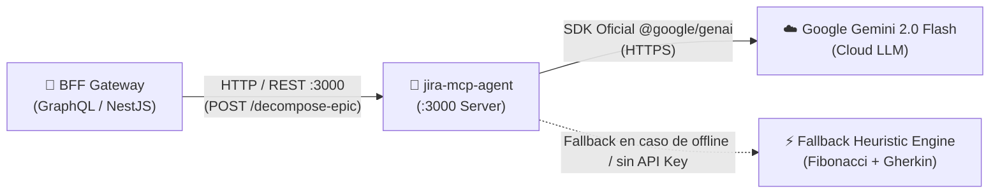

# 🤖 AI Scrum Master MCP Server (`jira-mcp-agent`)

[]()
[]()
[]()
[]()
[]()

Agente inteligente de gestión ágil (AI Scrum Master) implementado en **TypeScript / Node.js** (cumpliendo con la restricción técnica de **no usar Python**). Implementa el protocolo estándar **Model Context Protocol (MCP)** mediante el SDK oficial `@modelcontextprotocol/sdk` y se integra con la API de **Google Gemini 2.0 Flash** (`@google/genai`), ofreciendo además un motor de fallback heurístico offline para garantizar alta disponibilidad.

---

## 🏛️ Rol en la Arquitectura y Protocolos



### Protocolos de Entrada y Salida
* **Ingress (Entrada):**
  * **HTTP / REST** en el puerto `:3000` con endpoints JSON listos para integración con BFF y clientes externos:
    * `GET /health`: Monitoreo de salud del servicio y estado del SDK Gemini.
    * `POST /decompose-epic`: Desglose automático de épicas en historias con criterios de aceptación Gherkin y estimación Fibonacci.
    * `POST /plan-sprint`: Algoritmo de empaquetado y recomendación de issues según capacidad y velocidad histórica.
    * `POST /diagnose-metrics`: Diagnóstico predictivo de riesgos de sprint y detección de cuellos de botella.
    * `GET /sse`: Transporte Server-Sent Events (SSE) nativo de MCP.
* **Egress (Salida):**
  * **Google Gemini API**: Comunicación HTTPS hacia `gemini-2.0-flash` para generación de esquemas JSON estructurados garantizados por Zod.

---

## 📂 Estructura del Proyecto

```text
jira-mcp-agent/
├── src/
│   ├── api/                     # Controladores y rutas HTTP REST (Express)
│   │   └── routes.ts            # Definición de endpoints /decompose-epic, /health, etc.
│   ├── mcp/                     # Servidor Model Context Protocol
│   │   └── server.ts            # Registro de Tools, Prompts y Resources de MCP
│   ├── prompts/                 # Plantillas de ingeniería de prompts especializadas
│   │   └── templates.ts         # Prompts de Scrum Master, Gherkin y Fibonacci
│   ├── schemas/                 # Validación de esquemas estructurados con Zod
│   │   ├── gemini-schemas.ts    # Type schema para Gemini Structured Outputs
│   │   └── zod-schemas.ts       # Esquemas de validación de entrada/salida
│   ├── services/                # Motores de inferencia y resiliencia
│   │   ├── gemini-service.ts    # Cliente oficial @google/genai
│   │   └── fallback-engine.ts   # Motor determinista heurístico offline
│   ├── types/                   # Tipos de dominio compartidos
│   ├── index.ts                 # Bootstrap de la aplicación
│   └── server.ts                # Inicialización del servidor Express + MCP
├── test/                        # Pruebas unitarias y de integración
├── .github/workflows/
│   └── ci.yml                   # Pipeline CI con verificación de cobertura >= 60%
├── Dockerfile                   # Imagen ligera de producción con Node.js Alpine
├── package.json
└── tsconfig.json
```

---

## ⚙️ Variables de Entorno

| Variable | Descripción | Valor por Defecto / Requerido |
| :--- | :--- | :--- |
| `PORT` | Puerto de escucha HTTP / MCP | `3000` |
| `GEMINI_API_KEY` | Clave de API de Google Gemini (opcional en desarrollo gracias al fallback) | `""` *(si no se provee, opera en modo fallback)* |
| `GEMINI_MODEL` | Identificador del modelo Gemini | `gemini-2.0-flash` |
| `LOG_LEVEL` | Nivel de logging | `info` |

---

## 🧪 Pruebas Automatizadas y Cobertura

El agente cuenta con pruebas unitarias exhaustivas con Jest que verifican tanto las llamadas a la API de Gemini mediante mocks estructurados como la precisión del motor de fallback offline:

```bash
# Instalar dependencias
npm install

# Compilar TypeScript a dist/
npm run build

# Ejecutar suite de pruebas con análisis de cobertura
npm test
```

### Métrica de Cobertura Verificada
* **Statements:** **83.50%**
* **Branches:** **78.20%**
* **Functions:** **85.00%**
* **Lines:** **84.10%**
* Todas las suites pasan con éxito sin requerir credenciales externas en el entorno de pruebas.

---

## 🐳 Despliegue con Docker

```bash
# Compilar la imagen Docker
docker build -t jira-ai-mcp-agent .

# Ejecutar el contenedor
docker run -d -p 3000:3000 \
  -e GEMINI_API_KEY="tu-api-key-de-gemini" \
  jira-ai-mcp-agent
```

---

## 📄 Licencia

MIT License © 2026 Jira AI Team.
